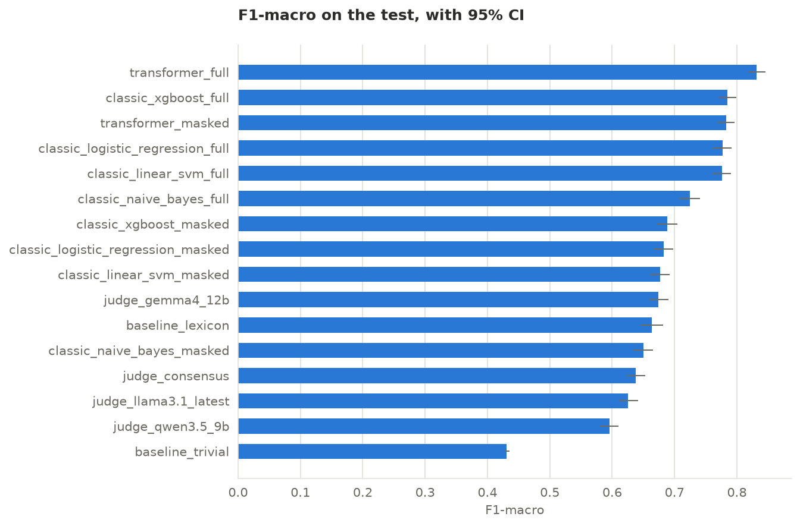

# Applying-Supervised-Classification-to-the-Detection-of-Gender-Bias

This repository gathers the practical project developed for the Machine Learning course, which addresses the automatic detection of sexism in texts posted on social networks. The work compares three families of approaches, namely classical classifiers trained on the TF-IDF representation, a transformer fine-tuned for the task and large language models (LLMs) used as judges, in addition to two baseline classifiers. With this, it is possible to evaluate not only which approach best detects gender bias, but also how much each one costs and how much its decisions depend on explicit offensive words.

## Research questions

This research revolves around the question of how different classification approaches behave in the detection of sexism. To answer this question, the experiment seeks to (i) identify which approach best detects sexism, (ii) verify whether the models learn any signal beyond the lexicon of offensive terms, (iii) evaluate whether the LLM-based judges are reliable and (iv) measure how much each approach costs in time and video memory. These four questions organize the final report of the run, which is generated automatically by the pipeline.

## Repository structure

The repository is divided into two folders. The `literature-review/` folder contains the `literature_review.xlsx` spreadsheet, where the protocol of the literature review is recorded, such as, for example, the research questions, the search string, the inclusion criteria and the selected studies. The `ml-project/` folder, on the other hand, contains the experiment, which is divided into `configs/`, which holds the single configuration of the experiment, the prompts of the judges and the definition of sexism used in the annotation, `scripts/`, which gathers the code of each stage, `data/` and `models/`, which receive the downloaded data and the trained models, and `results/`, which stores the tables, figures and predictions of each run.

The scripts follow the phases of the experiment. The `pipeline.py` file coordinates the whole run, `preparation.py` handles the download, cleaning and splitting of the data, `classical.py` and `transformer.py` train the classifiers, `judges.py` queries the LLMs and `evaluation.py` applies the models to the test set, compares the methods and generates the report. In addition, the `common.py` file holds the code shared between the stages, such as the metrics, the lexicon and the hyperparameter search spaces.

## Data and methodology

The data used comes from EDOS (Explainable Detection of Online Sexism), which corresponds to Task 10 of SemEval-2023. In this dataset, sexism is defined as any abuse or negative sentiment directed towards women because of their gender, or because of their gender combined with another identity, and this same definition is given to the judges. The official split of the dataset was kept, with 14,000 training texts, 2,000 development texts and 4,000 test texts, allowing the results to be compared with those of the task. In the cleaning step, the texts go through Unicode normalization (NFKC) and a search for near duplicates with MinHash, confirmed by a Jaccard index above 0.8, which removed two texts and resulted in 19,998 examples.

The classical classifiers, which are Complement Naive Bayes, Logistic Regression, linear SVM and XGBoost, have the TF-IDF representation and the hyperparameters optimized together by Optuna, with 60 trials per algorithm. Each trial is evaluated by the mean AUPRC in stratified cross-validation with five folds, and the decision threshold is chosen to maximize the macro F1, which is the official EDOS metric. The transformer, in turn, is DeBERTa-v3-base, tuned by an exhaustive search over the learning rate and the batch size and trained again with five seeds. The judges are three open models from different families, namely Gemma 4 12B, Qwen 3.5 9B and Llama 3.1, served locally by Ollama, which vote on whether the text is sexist, and the consensus is defined by the majority of the votes.

Another important point of the experiment is the masked scenario. In this scenario, the terms of the HurtLex lexicon linked to women are removed from every text, which makes it possible to verify whether the models recognize sexism even without the most obvious offensive words. In addition, the test set is only opened after the models, the thresholds and the prompts of the judges are frozen, preventing any decision from being made based on the test. Finally, the methods are compared through 95% confidence intervals obtained by bootstrap, the McNemar test with Holm correction and the AUC per subgroup, and the decisions of the models are interpreted with SHAP and LIME.

## How to run

To run the experiment, it is necessary to have Python 3 installed, an NVIDIA GPU with CUDA for training the transformer and Ollama installed for the judges. The run recorded in this repository was carried out with Python 3.12, a 12 GB NVIDIA GeForce RTX 3060 and 32 GB of RAM, and took about ten hours. The whole experiment is started by the command shown below.

```bash
cd ml-project
python3 scripts/pipeline.py
```

On the first run, the pipeline creates the `.venv` virtual environment, installs the dependencies from `requirements.txt` and restarts itself with the Python of this environment. Then, the stages are executed in order, from the download of the data to the final report, and each one runs in its own process. If the run is interrupted, it is enough to run the same command again, since the stages already finished are reused and a stage is only redone when its code, the configuration or a stage it depends on changes. It is also possible to point to another configuration and give a name to the run, as shown below.

```bash
python3 scripts/pipeline.py --config configs/config.yaml --run-name run-name
```

All the parameters of the experiment are in the `configs/config.yaml` file, such as, for example, the seed, the search spaces, the number of trials and the models used as judges. Each block of this file has a `references` field, which indicates the references that support the choices made, and these references are saved together with the values used in the `traceability.csv` table. In this way, each decision of the experiment can be traced back to the literature that supports it.

## Results

The results of each run are stored in `ml-project/results/`, organized in a subfolder with the name of the run. The `metrics/` folder contains the CSV tables and the `SUMMARY.md` file, which gathers the main tables of each research question, the `figures/` folder contains the charts and the confusion matrices, `predictions/` keeps the predictions of each method on the test set and `runs/` holds the state of the run, such as the answers of the judges and the cost records.

In the `main` run, DeBERTa-v3-base with the full text achieved the best result, with a macro F1 of 0.832 on the test set, followed by XGBoost, with 0.785. The consensus of the judges, on the other hand, reached a macro F1 of 0.638, below the supervised classifiers, but with an AUPRC of 0.724, close to that of the classical classifiers. In addition, it was observed that every classifier loses performance in the masked scenario, but the transformer kept the same AUC on the texts without lexicon terms, which indicates that it captures signals of sexism that go beyond offensive words. Figure 1 shows the macro F1 of each method on the test set.



Regarding the judges, the agreement between the three models was moderate, with a Krippendorff's alpha of 0.61, and Llama 3.1 was the only one that fell below 0.8 when the prompt was reworded. As for the cost, the judges took, on average, about 494 milliseconds per prediction in the consensus, while the transformer took 1.6 milliseconds and the classical classifiers less than 0.5 milliseconds. With this, it can be noted that, for this task, fine-tuning a supervised model proved to be more accurate and cheaper than using LLMs as judges.

## Authorship and license

This project was developed by Leticia Gonçalves Batista and Gustavo Santos Teixeira and is distributed under the MIT license, whose full text can be found in `ml-project/LICENSE`.
